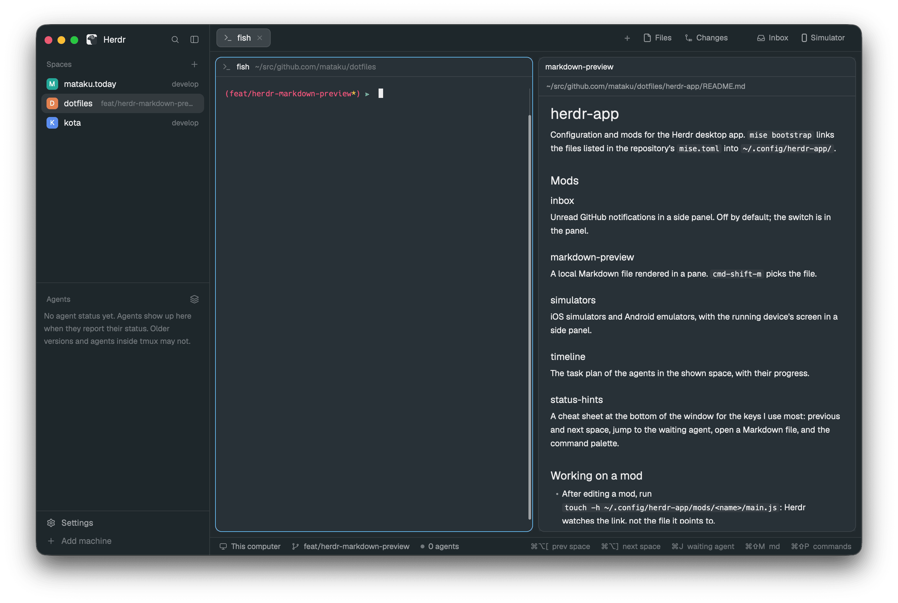
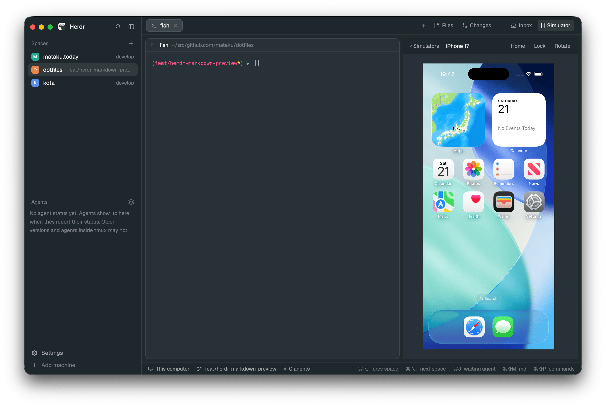

# herdr-app

Configuration and mods for the Herdr desktop app. `mise bootstrap` links the files listed in the repository's `mise.toml` into `~/.config/herdr-app/`.

## Mods

### containers

Docker containers in a popup, grouped by Compose project, with CPU, memory and ports, and a button to start or stop each. `cmd-shift-c` opens it; it reads `docker` every 30 seconds while it is open and never while it is closed.

### inbox

Unread GitHub notifications in a side panel. Off by default; the switch is in the panel.

### markdown-preview

A local Markdown file rendered in a pane. `cmd-shift-m` picks the file.

### simulators

iOS simulators and Android emulators, with the running device's screen in a side panel.

### timeline

The task plan of the agents in the shown space, with their progress.

### status-hints

A cheat sheet at the bottom of the window for the keys I use most: previous and next space, jump to the waiting agent, open a Markdown file, open the containers popup, and the command palette.
