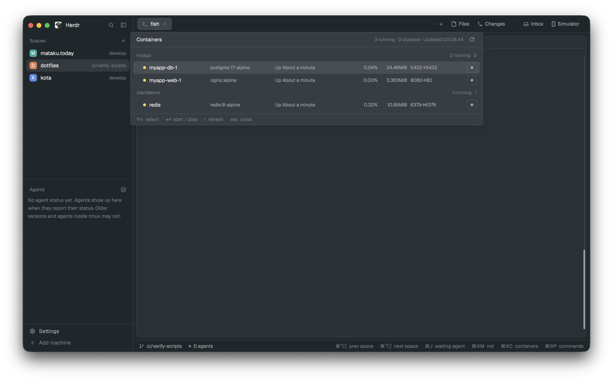

# herdr-app

Configuration and mods for the Herdr desktop app. `mise bootstrap` links the files listed in the repository's `mise.toml` into `~/.config/herdr-app/`.

## Mods

### containers

Docker containers in a popup, grouped by Compose project, with CPU, memory and ports, and a button to start or stop each. `cmd-shift-c` opens it; it reads `docker` every 30 seconds while it is open and never while it is closed.

### inbox

Unread GitHub notifications in a side panel. Off by default; the switch is in the panel.

### markdown-preview

A local Markdown file rendered in a pane. `cmd-shift-m` picks the file.

### session-history

Past Claude Code sessions of the focused terminal's repository in a popup, newest first. `cmd-shift-r` opens it; `ctrl-o` or a click on `Other folders` shows the sessions of all other folders too. Typing filters by title, folder and the first recorded prompt, and after a short pause also looks through the transcripts' text. Enter resumes the session in a new tab in its folder.

### scheduled-tasks

Agents started on a schedule: every 15, 30 or 60 minutes on the clock, or daily at a quarter-hour time on chosen weekdays. The `Tasks` button in the top bar opens the list, where tasks are added, edited and switched on and off. `o` shows a task's runs: the live one as a peek, and the last five ended ones as what their terminal kept, which is the whole output of a script, and for a `claude` run the way to open its session in a new tab.

Tasks are kept in `~/.config/herdr-app/scheduled-tasks.json`, which can be edited by hand and copied to another machine. A command is split at spaces, so its arguments cannot hold one.

Tasks run only while Herdr is open with the `personal` layout shown. The mod looks at the clock on the quarter hour only, and not at all while no valid task is switched on. So a change made by hand in the file while nothing is switched on, the repair of a broken file included, counts from the next time the popup is opened, and a file that cannot be read never makes the mod start to wake. Fires missed while Herdr is closed or the Mac sleeps are dropped.

Each task has one live terminal named `sched-<name>`. It is ended at the task's next fire once it has stopped, and a fire is skipped while it still runs or waits. Deleting a task in the screen ends and removes its runs; the `Tasks` button does this, so it goes on when the popup is closed and waits while another layout is shown. Those runs, like the limit of five, are terminals kept by herdr-core and never Claude Code sessions, which stay under `~/.claude/projects` and in `session-history`. The runs of a task removed from the file by hand are found with `hc ls --all` under that name and removed with `hc kill` and `hc rm`.

### simulators

iOS simulators and Android emulators, with the running device's screen in a side panel.

### timeline

The task plan of the agents in the shown space, with their progress.

### status-hints

A cheat sheet at the bottom of the window for the keys I use most: previous and next space, jump to the waiting agent, open a Markdown file, open the containers popup, and the command palette.
